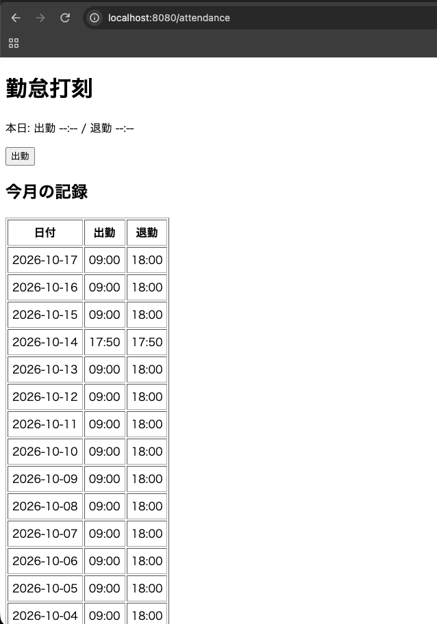
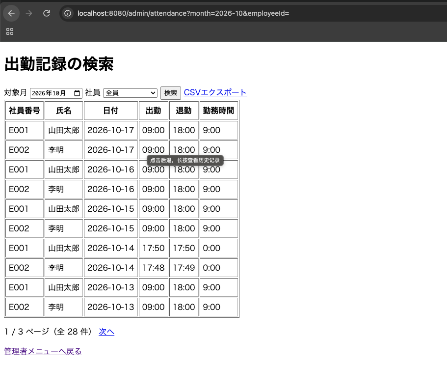
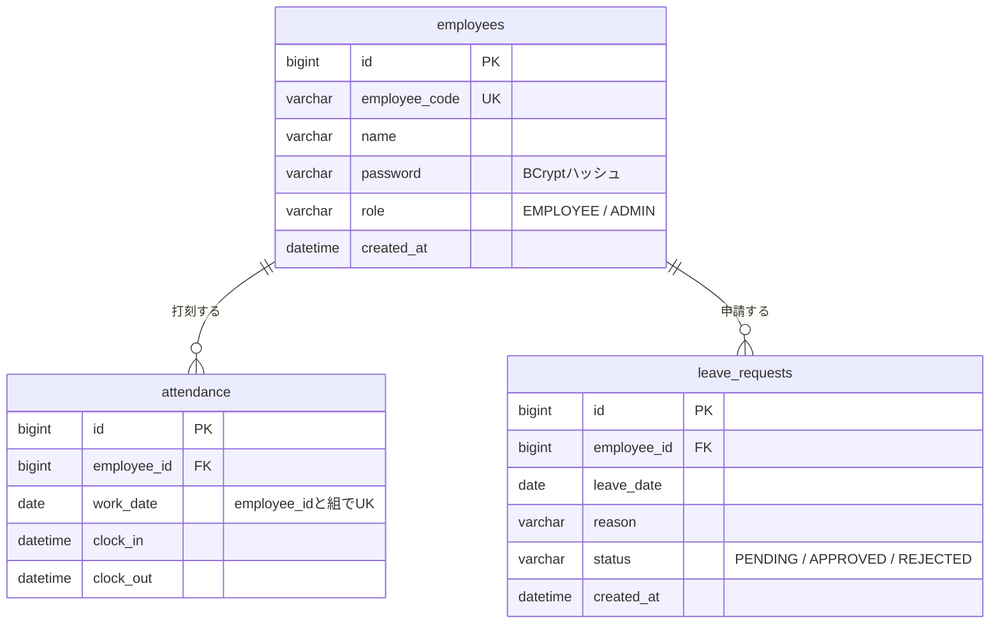

# 勤怠管理システム（kintai）

社員の出退勤打刻、休暇申請、管理者による承認、出勤記録の検索・CSV出力ができる勤怠管理システムです。
Java / Spring Boot の学び直しと、業務システムで必要になる要素（認証・認可、入力チェック、二重処理の防止、テスト）を意識して作成しました。

## 主な機能

**一般社員**
- ログイン / ログアウト
- 出勤・退勤の打刻（同じ日の二重打刻は不可）
- 今月の打刻記録の確認
- 休暇申請（過去日・同日の重複申請は不可）と申請状況の確認

**管理者**
- 休暇申請の承認・却下（自分の申請は処理不可）
- 出勤記録の検索（月・社員で絞り込み）、ページング
- 出勤記録の CSV エクスポート（Excel で文字化けしない UTF-8 BOM 付き）

## 技術スタック

| 区分 | 使用技術 |
|------|----------|
| 言語 | Java 17 |
| フレームワーク | Spring Boot 4.1 / Spring Security / Spring Web MVC |
| 画面 | Thymeleaf |
| DB アクセス | MyBatis（アノテーション + 動的 SQL） |
| DB | MySQL 8 |
| テスト | JUnit 5 / Mockito / AssertJ |
| ビルド | Maven |

## セットアップ

必要なもの：JDK 17 以上、MySQL 8

1. リポジトリを取得
```bash
   git clone https://github.com/VVNeosoul/kintai.git
   cd kintai
```
2. データベースを作成
```bash
   mysql -u root -p < db/schema.sql
```
3. DB のパスワードを設定する `src/main/resources/application-local.properties` を作成（Git 管理対象外）
```properties
   spring.datasource.password=あなたのMySQLパスワード
```
※ 接続先やユーザー名は `application.properties` に記載しています。
4. 起動
```bash
   ./mvnw spring-boot:run
```
5. ブラウザで http://localhost:8080 を開く

## デモ用アカウント

起動時に `DataInitializer` が自動作成します（開発・デモ専用。本番では使用しない想定です）。

| 社員番号 | パスワード | 権限 |
|----------|------------|------|
| E001 | password123 | 管理者 |
| E002 | password123 | 一般社員 |

## 画面イメージ




## 画面一覧

| URL | 内容 | 権限 |
|-----|------|------|
| `/login` | ログイン | 全員 |
| `/` | ホーム | ログイン済み |
| `/attendance` | 打刻・今月の記録 | ログイン済み |
| `/leave` | 休暇申請・履歴 | ログイン済み |
| `/admin` | 管理者メニュー | 管理者 |
| `/admin/leave` | 休暇申請の承認・却下 | 管理者 |
| `/admin/attendance` | 出勤記録の検索・CSV 出力 | 管理者 |

## データベース設計



## 設計上のポイント

- **二重打刻の防止**：Service での事前チェックに加え、`(employee_id, work_date)` の一意制約で DB 側でも防止。同時リクエストで一意制約違反が起きた場合も、業務エラーとして扱います。
- **二重処理の防止**：退勤の更新は `clock_out IS NULL`、承認・却下の更新は `status = 'PENDING'` を条件にした UPDATE とし、更新件数が 0 の場合はエラーにしています。
- **認証・認可**：Spring Security によるフォームログイン。パスワードは BCrypt でハッシュ化して保存。`/admin/**` は管理者のみアクセス可。さらに Service 層で「自分の申請は承認できない」ことを検証しています。
- **入力チェックの分離**：形式のチェック（必須・文字数）は Bean Validation、業務ルール（過去日・重複）は Service で実施。
- **フォームとエンティティの分離**：画面の入力項目とテーブル構造を分け、不要な項目（status など）が画面から書き換えられないようにしています。
- **日時の扱い**：考勤の基準日は `Asia/Tokyo` を明示。サーバーのタイムゾーンに依存しません。
- **二重送信対策**：登録系の処理は完了後にリダイレクト（Post-Redirect-Get）。
- **CSRF 対策**：Spring Security 標準の CSRF トークンを使用（Thymeleaf の `th:action`）。
- **SQL インジェクション対策**：MyBatis の `#{}`（プリペアドステートメント）のみを使用。

## テスト

Service 層の業務ルールについて、Mockito で DB をモック化した単体テストを 16 件実装しています。

```bash
./mvnw test
```

- 打刻：正常系、二重出勤、出勤なしの退勤、二重退勤、同時実行による一意制約違反・更新件数 0
- 休暇：正常系、過去日、同日の重複申請、承認・却下、自分の申請、処理済み、存在しない申請

## プロジェクト構成

```
src/main/java/com/example/kintai
├── config       # Spring Security 設定、ユーザー取得、デモデータ作成
├── controller   # 画面の入口
├── service      # 業務ロジック
├── mapper       # MyBatis（SQL）
├── entity       # テーブルに対応するクラス
├── form         # 画面入力用クラス（入力チェック付き）
├── dto          # 検索結果・ページング用
└── exception    # 業務例外
```

## 今後の課題

- 現在時刻を `Clock` として注入し、時刻に依存するテストを安定させる
- 休暇申請の重複防止を DB 制約でも担保する（却下後の再申請との両立を設計する）
- 勤務時間の計算に休憩時間を反映する
- データ量が増えた場合のページング方式（OFFSET → キーセット）の見直し
- 画面デザインの改善、Docker での起動対応